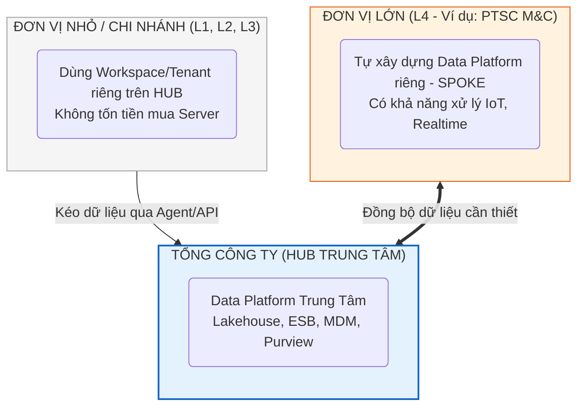
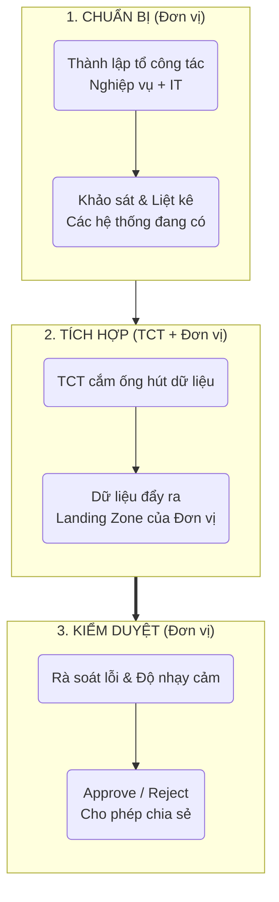
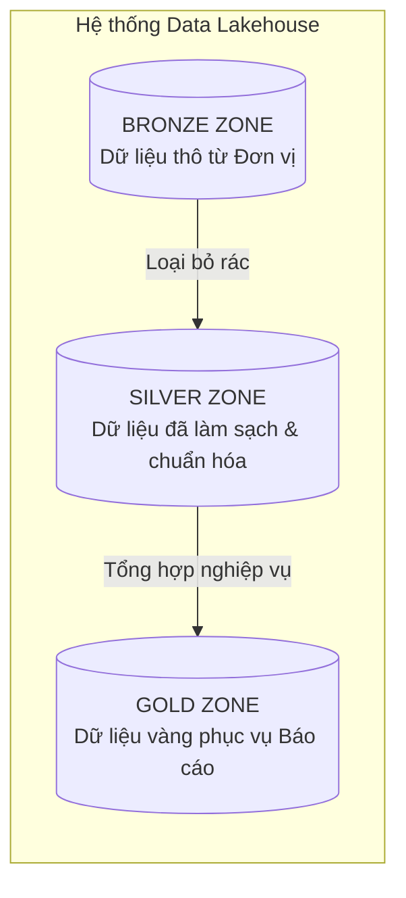
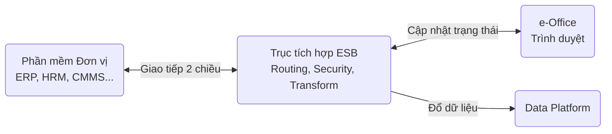
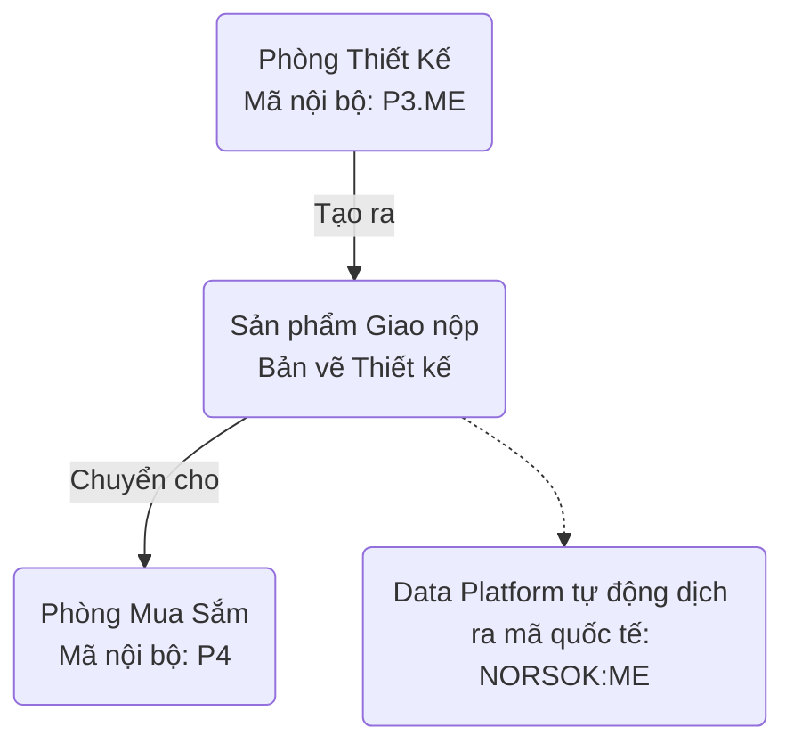

# TỔNG QUAN DATA PLATFORM PTSC & HƯỚNG DẪN CHO ĐƠN VỊ THÀNH VIÊN

Tài liệu này được tổng hợp từ các phiên hội thảo của PTSC nhằm trả lời 2 câu hỏi cốt lõi: **Data Platform của PTSC sinh ra để làm gì?** và **Các Đơn vị thành viên (Công ty con/Chi nhánh) cần phải làm những gì?**

---

## PHẦN 1: DATA PLATFORM LÀ GÌ VÀ ĐỂ LÀM GÌ?

### 1. Nỗi đau hiện tại (Bối cảnh)
* **Phân mảnh dữ liệu (Data Silos):** Mỗi phòng ban, đơn vị tự mua/xây một phần mềm riêng (ERP, HRM, e-Office...). Dữ liệu nằm rải rác, mạnh ai nấy giữ.
* **Báo cáo thủ công:** Ban Giám đốc muốn xem báo cáo toàn TCT thì nhân viên phải xuất file Excel từ hàng chục nơi, copy/paste và ghép lại (dễ sai sót, mất thời gian, không realtime).
* **Loạn chuẩn dữ liệu (Master Data):** Cùng một cái máy bơm, đơn vị A đặt mã là `BOM-01`, đơn vị B đặt mã là `M001`. Khi cộng gộp báo cáo không thể biết đó là cùng một loại thiết bị.

### 2. Data Platform giải quyết thế nào?
Data Platform của PTSC là một hệ sinh thái tập trung, đóng vai trò như một **"Nhà máy xử lý dữ liệu"** kết hợp với **"Bưu điện giao vận"**:
1. **Nhà máy xử lý (Lakehouse):** Hút toàn bộ dữ liệu thô từ các phần mềm cũ của mọi đơn vị đổ về một hồ chứa. Tại đây dữ liệu được làm sạch, đồng nhất mã, và chế biến thành các "Bản ghi vàng" (Golden Record) để phục vụ Dashboard, AI/ML.
2. **Bưu điện giao vận (Trục tích hợp ESB):** Thay vì các phần mềm tự gọi nhau chằng chịt, tất cả cắm vào trục ESB. ESB giúp đồng bộ dữ liệu (cả 1 chiều và 2 chiều) tự động và an toàn.
3. **Phiên dịch viên (Mô hình ngành PPDM - Dual Code):** Nó cho phép hệ thống tự động dịch từ mã nội bộ quen thuộc của PTSC (ví dụ `P3.ME`) sang mã chuẩn quốc tế (như `NORSOK`) để báo cáo cho khách hàng Tây mà không cần đập bỏ hệ thống cũ.

---

## PHẦN 2: MÔ HÌNH TRIỂN KHAI (TCT VÀ ĐƠN VỊ)

PTSC không ép tất cả các đơn vị dùng chung một cách cứng nhắc. TCT áp dụng mô hình **Hub - Spoke** linh hoạt chia theo năng lực của từng đơn vị:

* **Luật chơi chung (Data Governance):** Bất kể là đơn vị lớn hay nhỏ, dữ liệu đưa lên Data Platform đều bị cách ly bằng quyền (RBAC/ABAC). Đơn vị nào chỉ được nhìn thấy và quản lý dữ liệu của đơn vị đó. Tuyệt đối tôn trọng **Chủ quyền dữ liệu**.

---

## PHẦN 3: VẬY ĐƠN VỊ THÀNH VIÊN PHẢI LÀM NHỮNG GÌ?

Các Đơn vị thành viên **không phải** là người đi code Data Platform. Vai trò của Đơn vị là **"Data Owner" (Chủ sở hữu dữ liệu)**. Dưới đây là 4 việc quan trọng nhất Đơn vị phải làm:

### 1. Tổ chức con người (Quản trị 5 cấp)
* Đơn vị phải cử ra các đầu mối: **Lãnh đạo đơn vị** (Chủ sở hữu dữ liệu cấp cao) và **Đầu mối nghiệp vụ + IT**.
* Trách nhiệm: Hiểu rõ dữ liệu của mình, phân loại đâu là dữ liệu mật, đâu là dữ liệu được phép chia sẻ.

### 2. Mở cửa hệ thống cũ để tích hợp (Landing Zone)
* Phối hợp với đội IT của TCT khảo sát xem phần mềm Kế toán, Nhân sự, Quản lý kho... của Đơn vị đang nằm ở đâu.
* Cho phép TCT cắm các luồng API hoặc công cụ (CDC) để hút dữ liệu thô (Raw Data) đưa ra một vùng đệm gọi là **Landing Zone**. (TCT sẽ lo phần kỹ thuật).

### 3. "Kiểm duyệt viên" (Data Quality & Approval)
* Khi dữ liệu được hút ra Landing Zone, nó **chưa** được ném vào vùng dùng chung.
* **Đơn vị phải là người duyệt (Approve):** Xác nhận dữ liệu này đã sạch, đã che (masking) các thông tin nhạy cảm (như lương thưởng cá nhân), và đồng ý chia sẻ thì TCT mới được đem đi tổng hợp.

### 4. Chia sẻ Chi phí
* Dùng hạ tầng chung (HUB) thì không mất tiền mua máy chủ (CAPEX), nhưng sẽ phải chia sẻ chi phí Vận hành và Bản quyền phần mềm (License) tùy theo mức độ sử dụng. 
* Nếu đơn vị thiếu ngân sách, TCT có thể đầu tư trước và ghi nợ.

---

## PHẦN 4: CÁC SƠ ĐỒ KỸ THUẬT QUAN TRỌNG

### 1. Kiến trúc lưu trữ Lakehouse (Medallion)
Mô tả hành trình dữ liệu được "giặt giũ" từ bùn đất (Bronze) thành vàng (Gold).

### 2. Trục tích hợp trung tâm (ESB)
Không ai được nối điểm-điểm. Tất cả phải qua ESB để kiểm soát và lưu vết (Audit Log). ESB hỗ trợ đồng bộ 2 chiều (vd: e-Office duyệt xong, trả kết quả về ERP tự động).

### 3. Nguyên tắc Kiến trúc Ngành Kép (PPDM Dual-Code)
Giải quyết bài toán "lệch chuẩn" bằng cách dùng một lớp trung gian (Sản phẩm giao nộp - Deliverable).

> [!NOTE]
> **Tóm lại cho Ban lãnh đạo Đơn vị:**
> Data Platform của TCT không cướp dữ liệu của đơn vị. Nó là công cụ giúp chuẩn hóa mớ hỗn độn hiện tại. Đơn vị chỉ cần "mở cửa" phần mềm cũ, kiểm duyệt nội dung chia sẻ, TCT sẽ lo phần "xây đường ống" và trả lại cho đơn vị những báo cáo BI, AI chính xác và xịn sò hơn.
